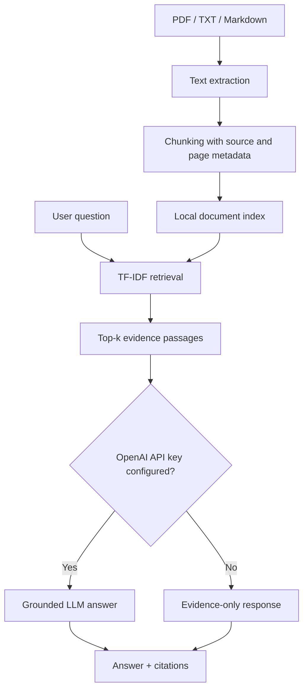

# Pharma Knowledge Assistant — RAG Document Intelligence

A GitHub-ready portfolio project demonstrating a document-grounded GenAI application for pharmaceutical reference documents. It supports PDF/TXT/Markdown ingestion, chunking, retrieval, source/page citations, an optional OpenAI answer-generation layer, a Streamlit UI, a FastAPI service, and automated tests.

> **Safety and scope:** This is an educational prototype. Use only public or synthetic documents. Do not upload patient records, personal data, confidential company documents, or regulated data. It is not a validated medical device, clinical decision-support tool, or source of medical advice. Always verify information against approved controlled documents.

## Features

- Upload and index PDF, TXT and Markdown documents.
- Preserve source filename and page number for citations.
- Split text into overlapping chunks.
- Retrieve relevant passages using TF-IDF vectors and cosine similarity (runs locally).
- Optional OpenAI-powered grounded answer generation.
- Retrieval-only fallback when no API key is configured.
- FastAPI endpoints for health, document upload, asking questions and clearing the index.
- Streamlit interface with retrieved evidence and relevance scores.
- Input validation, file type/size limits and basic automated tests.

## Architecture



## Project structure

```text
pharma_knowledge_assistant/
├── app/
│   ├── answering.py
│   ├── config.py
│   ├── ingestion.py
│   ├── main.py
│   ├── retrieval.py
│   ├── store.py
│   └── ui.py
├── data/
│   └── sample_docs/
├── tests/
├── .env.example
├── .gitignore
├── Dockerfile
├── render.yaml
├── requirements.txt
└── README.md
```

## 1. Setup

Python 3.10–3.12 is recommended.

```bash
# Create and activate a virtual environment
python -m venv .venv

# Windows PowerShell
.venv\\Scripts\\Activate.ps1

# Ubuntu / macOS
source .venv/bin/activate

# Install dependencies
pip install -r requirements.txt
```

## 2. Configure (optional OpenAI generation)

Copy `.env.example` to `.env` and add your own API key if you want LLM-generated answers.

```bash
# Windows
copy .env.example .env

# Ubuntu / macOS
cp .env.example .env
```

Without an API key, the project still works and returns retrieved evidence passages. Never commit `.env`.

## 3. Run the Streamlit app

```bash
streamlit run app/ui.py
```

Open the local URL shown in the terminal. Upload `data/sample_docs/sample_storage_sop.txt`, click **Index document**, and ask:

- What are the sample storage conditions?
- What information should be included in records?
- What should happen if a temperature reading is outside the example range?

## 4. Run the FastAPI service

```bash
uvicorn app.main:app --host 0.0.0.0 --port 8000 --reload
```

Open `http://localhost:8000/docs` for interactive API documentation.

### API endpoints

| Method | Endpoint | Purpose |
|---|---|---|
| GET | `/health` | Service status and indexed chunk count |
| POST | `/documents` | Upload PDF/TXT/MD as multipart form data |
| POST | `/ask` | Ask a question using JSON |
| DELETE | `/documents` | Clear the document index |

Example ask request:

```bash
curl -X POST http://localhost:8000/ask \\
  -H "Content-Type: application/json" \\
  -d '{"question":"What are the sample storage conditions?","top_k":4}'
```

## 5. Run tests

```bash
pytest -q
```

## 6. Deploy

### Render (Streamlit)
1. Push this repository to GitHub.
2. In Render, create a **New → Web Service** and connect the repository.
3. Use build command: `pip install -r requirements.txt`
4. Use start command: `streamlit run app/ui.py --server.address 0.0.0.0 --server.port $PORT`
5. Add `OPENAI_API_KEY` as a secret environment variable only if using OpenAI generation.

For a persistent deployment, configure a persistent disk and set `DATA_DIR` to its mount path. Without persistent storage, uploaded documents may be lost when the service restarts or redeploys. Protect any deployed instance before allowing public uploads.

### Docker

```bash
docker build -t pharma-knowledge-assistant .
docker run --rm -p 8501:8501 pharma-knowledge-assistant
```

## Engineering notes and limitations

- The default retriever uses TF-IDF, a lightweight local vector-space baseline. It is not a transformer embedding model. For a stronger production RAG implementation, swap `app/retrieval.py` for an approved embedding model and vector database (for example, a governed embedding endpoint plus FAISS/Chroma).
- The optional OpenAI layer sends retrieved text to the configured provider. Only use public/synthetic data unless your organization has explicitly approved the provider and data flow.
- The fallback response displays evidence rather than pretending to synthesize an answer.
- Relevance scores are ranking signals, not calibrated confidence probabilities.
- Scanned PDFs may require OCR; OCR is not included.
- This project does not establish regulatory compliance, clinical validity, or production readiness.

## Suggested evaluation plan

Create a held-out set of 20–50 questions from public/synthetic documents. Record expected source pages and key facts. Evaluate:
- Retrieval hit rate@k: whether the expected source appears in top-k.
- Citation correctness: whether each cited source/page supports the claim.
- Answer completeness and relevance: human rubric (0–2).
- Unsupported-claim rate: unsupported factual claims divided by factual claims.
- Regression: compare results after changing chunk size, retrieval method or prompt.

## Resume positioning

Use only after you have run the application, tested it, and can explain the implementation.

**Pharma Knowledge Assistant | Python, RAG, FastAPI, Streamlit, OpenAI API, scikit-learn**
- Developed a document-grounded RAG application to ingest pharmaceutical reference documents, retrieve relevant passages and generate evidence-linked responses.
- Implemented page-aware chunking, TF-IDF retrieval, source citations and a grounded LLM generation layer with an evidence-only fallback.
- Exposed ingestion and question-answering capabilities through FastAPI and built a Streamlit interface with automated tests and configurable deployment.

Do not claim transformer embeddings, FAISS, Chroma, clinical validation, or production deployment unless you actually implement and verify them.
